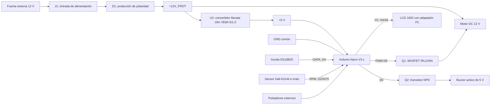

# Proyecto mini-bioreactor electrónica biomédica

Este proyecto consiste en desarrollar un mini-biorreactor educativo de bajo costo, entendido como un sistema de cultivo a pequeña escala que permite estudiar y simular condiciones controladas de un proceso biológico. Debido a su finalidad educativa, el sistema trabajará exclusivamente con agua u otras mezclas inocuas, sin cultivar microorganismos. El proyecto busca representar, de manera sencilla y segura, el funcionamiento general de un biorreactor mediante la regulación de las condiciones del recipiente, el monitoreo de su comportamiento y teniendo como variable regulada, la temperatura del fluido.

Este proyecto contiene una placa electrónica de control para un mini biorreactor. Su elemento principal es una placa de desarrollo Arduino nano D3, que ejecuta el programa de control y recibe las señales de los sensores.

La electrónica se alimenta con una fuente de 12 V. Un diodo Schottky protege la entrada frente a inversión de polaridad; un regulador convierte los 12 V a 5 V para alimentar la placa y la pantalla, y otro regulador genera 3,3 V para los sensores y las señales de control.

Un MOSFET IRLZ44N permite regular la velocidad de un motor de corriente continua mediante una señal PWM del ESP32. Un diodo de protección y un condensador ayudan a reducir los picos eléctricos producidos por el motor. La placa también incorpora conectores para un sensor de temperatura DS18B20 y un sensor Hall de RPM, además de resistencias de polarización para sus señales.

Para la interfaz, hay un conector para una pantalla LCD 16×2 con comunicación I²C. Un adaptador de nivel con transistores BSS138 permite comunicar las señales I²C de 3,3 V del arduino con una pantalla que funciona a 5 V. También hay un conector de programación USB-UART y pulsadores para encendido/apagado, regulación, reinicio y modo de carga del arduino.

En conjunto, la electrónica permite controlar el motor y reunir las lecturas de temperatura y velocidad de giro para supervisar el funcionamiento del mini biorreactor.

## Diagrama actualizado del sistema

## Firmware

El hardware está basado en un **Arduino Nano V3.x clásico (ATmega328P)**. El firmware previsto leerá una sonda DS18B20 y un sensor Hall A3144, controlará el motor mediante PWM y gestionará la pantalla LCD 1602, los pulsadores y el buzzer.

**El repositorio aún no incluye el código fuente del firmware.** Por ello, todavía no hay un comando ejecutable de compilación o carga ni se pueden confirmar las librerías que usará el programa.

### Herramientas y dependencias previstas

- Arduino CLI.
- Plataforma Arduino IDE

### Resultados esperados 

El usuario debería poder compilar el código adjunto en (insertar link), configurando el monitor serial en 11550 baudios, enviando una señal de temperatura y velocidad que podrá ser visualizada cada (cierto intervalo de tiempo) en la pantalla. El hardware de instalación consta de un cable (nombre del cable que va de la placa al computador), que conecta Arduino Nano V3 con el dispositivo empleado con puerto USB para enviar el código. 

